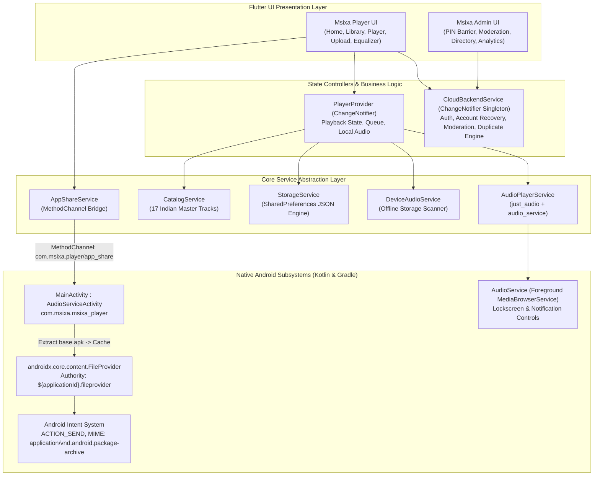
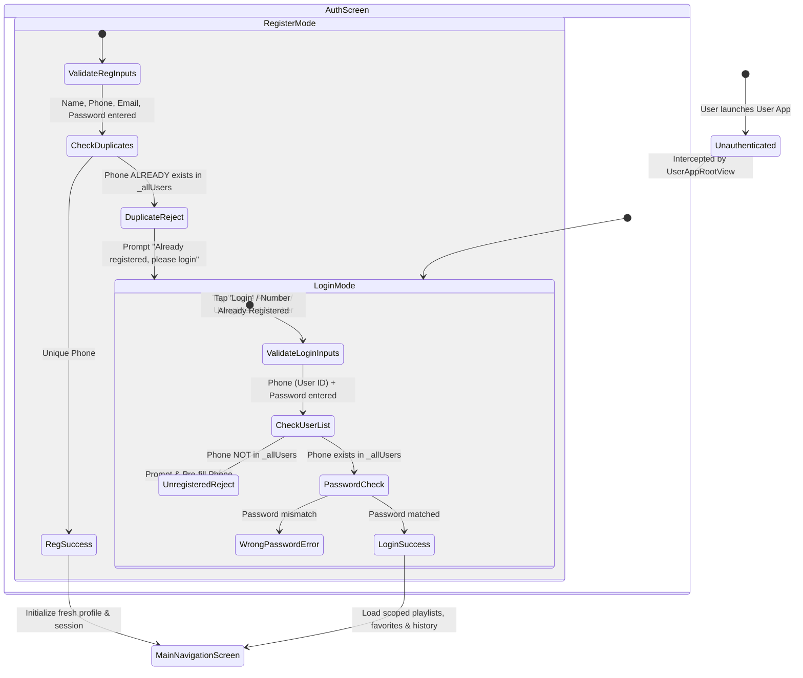
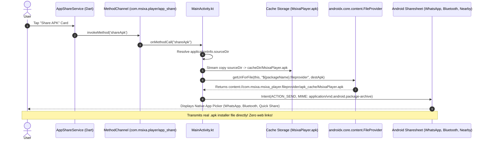

# 🛠️ TECHNICAL ARCHITECTURE & THEORETICAL REFERENCE SPECIFICATION
## System: Msixa Player & Msixa Admin Ecosystem
**Codebase Language:** Dart / Flutter (`>= 3.0.0`) & Kotlin (Android Native Layer)  
**Document Classification:** Engineering Design & QA Test Specification  
**Version:** 3.0 (Production Master Release with R2 CDN & OTA In-App Updater)  
**Archive Location:** `library/technical/TECHNICAL_ARCHITECTURE_THEORETICAL_SPEC.md`  

---

## 1. System High-Level Architecture Diagram



---

## 2. Directory & Component Mapping

| Subdirectory | Core Files | Responsibility |
| :--- | :--- | :--- |
| `lib/models/` | `song.dart`, `user_profile.dart`, `playlist.dart`, `equalizer_preset.dart` | Immutable data structures, serialization (`toJson`/`fromJson`), and domain constraints. |
| `lib/services/` | `cloud_backend_service.dart`, `audio_player_service.dart`, `catalog_service.dart`, `app_share_service.dart`, `storage_service.dart`, `device_audio_service.dart` | Business logic, state synchronization, hardware abstraction, and audio decoding. |
| `lib/providers/` | `player_provider.dart` | Primary view-model orchestrating the audio queue, playback status, sleep timer, and equalizer curves. |
| `lib/screens/` | `home_screen.dart`, `upload_song_screen.dart`, `now_playing_screen.dart`, `search_screen.dart`, `library_screen.dart`, `equalizer_screen.dart` | User App views styled in obsidian dark theme. |
| `lib/screens/auth/` | `auth_screen.dart` | Direct listener onboarding with 3 mandatory fields & instant playlist recovery. |
| `lib/screens/admin/` | `admin_dashboard_screen.dart` | Executive analytics, audio preview player, pending moderation, and user directory CRM. |
| `lib/` | `main.dart`, `main_admin.dart` | Entry points for User App and Admin App respectively. |
| `android/` | `AndroidManifest.xml`, `build.gradle`, `settings.gradle`, `file_paths.xml` | Native permissions, FileProvider registry, and Gradle dependency overrides. |
| `.github/workflows/` | `build_apk.yml` | Multi-target CI/CD compilation generating release APK artifacts. |

---

## 3. Deep Dive: State Management & Service Singletons

### 3.1 `CloudBackendService` Singleton Pattern
`CloudBackendService` acts as the simulated platform backend and central source of truth for both apps:
- **Instance Guarantee:** Implemented via a private constructor `CloudBackendService._internal()` and factory `CloudBackendService()`.
- **Reactivity:** Extends `ChangeNotifier`. Any modification (`approveSong`, `submitUserSong`, `completeVerification`) triggers `notifyListeners()`, causing all subscribed UI views to refresh automatically without page reloads.
- **Persistence Layer:** Uses `SharedPreferences` storing serialized JSON strings:
  - `msixa_current_user`: Active session profile.
  - `msixa_all_registered_users`: Full user directory array.
  - `msixa_community_songs`: All submitted, pending, and approved tracks.

### 3.2 User Authentication State Machine (User ID: Phone, Password-Based)



---

## 4. Deep Dive: Real-Time Duplicate Song Detection Algorithm

When an authenticated listener initiates a song upload in `UploadSongScreen`, the algorithm prevents catalog bloat and duplicate submissions.

### Theoretical Mathematical Formulation
Let the candidate track be defined as:
$$T_{new} = \{ \text{title}, \text{artist} \}$$
Let the combined song catalog be $C = C_{curated} \cup C_{community}$.

1. **Normalization Function $\mathcal{N}(s)$:**
   $$\mathcal{N}(s) = \text{trim}(\text{lowercase}(\text{regex\_replace}(s, [^\w\s], ""))) $$

2. **Matching Metric:**
   A match is flagged if:
   $$(\mathcal{N}(T_{new}.\text{title}) = \mathcal{N}(S.\text{title})) \lor \left(|\mathcal{N}(T_{new}.\text{title})| > 4 \land \mathcal{N}(S.\text{title}) \subset \mathcal{N}(T_{new}.\text{title})\right) \lor \left(|\mathcal{N}(S.\text{title})| > 4 \land \mathcal{N}(T_{new}.\text{title}) \subset \mathcal{N}(S.\text{title})\right)$$
   AND the artist name is either empty or shares a substring match:
   $$\mathcal{N}(T_{new}.\text{artist}) \subset \mathcal{N}(S.\text{artist}) \lor \mathcal{N}(S.\text{artist}) \subset \mathcal{N}(T_{new}.\text{artist})$$

3. **Runtime Execution Flow:**
   - If match found: Yields matched `Song` instance $\rightarrow$ UI presents dialog with direct play option $\rightarrow$ upload halted.
   - If no match found: Yields `null` $\rightarrow$ upload proceeds to Admin moderation queue.

---

## 5. Deep Dive: Native Direct APK File Sharing via FileProvider

### 5.1 The Android Security Sandbox Problem
Android prevents applications from exposing raw private filesystem paths (e.g., `file:///data/app/.../base.apk`) to external applications. Attempting to share such paths triggers a fatal `FileUriExposedException` on Android 7.0 (API 24) and above.

### 5.2 The Native Architectural Solution
Msixa implements a native `MethodChannel` bridging Flutter to Android's secure `FileProvider`:



### 5.3 Configuration Files
1. **`android/app/src/main/res/xml/file_paths.xml`:**
   ```xml
   <paths xmlns:android="http://schemas.android.com/apk/res/android">
       <cache-path name="apk_cache" path="." />
       <external-cache-path name="ext_cache" path="." />
       <external-path name="ext_files" path="." />
   </paths>
   ```
2. **`AndroidManifest.xml` Provider Declaration:**
   ```xml
   <provider
       android:name="androidx.core.content.FileProvider"
       android:authorities="${applicationId}.fileprovider"
       android:exported="false"
       android:grantUriPermissions="true">
       <meta-data
           android:name="android.support.FILE_PROVIDER_PATHS"
           android:resource="@xml/file_paths" />
   </provider>
   ```

---

## 6. Deep Dive: Audio Engine, Equalizer & Foreground Media Service

### 6.1 Audio Playback Engine
Msixa uses `just_audio` coupled with `audio_service` running on an isolated background isolate:
- **Audio Formats Supported:** MP3 (MPEG-1 Audio Layer III), M4A (AAC-LC), WAV, OGG Vorbis.
- **Buffer Management:** Dynamic buffering with `bufferedPositionStream` emitting live progress to the seek bar.
- **Audio Routing:**
  - `assets/audio/...`: Read directly from compiled APK asset bundle via asset descriptor streams.
  - `/storage/emulated/0/...`: Read from device storage with read permissions.
  - `http://` / `https://`: Streamed via HTTP audio sink with background caching.

### 6.2 5-Band Graphic Equalizer Engine
The equalizer applies discrete frequency band gains ($-10.0\text{ dB}$ to $+10.0\text{ dB}$) across 5 standard center frequencies:
1. **Band 0 (60 Hz - Sub-Bass):** Controls sub-woofers, kick drums, and foundational bass depth.
2. **Band 1 (230 Hz - Low Mid/Bass):** Controls bass guitars, male vocal body, and warm acoustics.
3. **Band 2 (910 Hz - Midrange):** Controls vocal clarity, dholak/tabla pitch, and string instruments.
4. **Band 3 (3.6 kHz - High Mid):** Controls vocal presence, attack, and percussion snap.
5. **Band 4 (14 kHz - Treble/Air):** Controls cymbal sheen, atmosphere, and high-frequency sparkle.

---

## 7. Multi-Target CI/CD Build Pipeline

The GitHub Actions workflow (`.github/workflows/build_apk.yml`) compiles both production APK targets deterministically:

1. **Environment Setup:** Ubuntu latest, JDK 17, Flutter 3.22.x stable.
2. **Dependency Resolution:**
   Enforces Kotlin version `1.8.22` / `1.9.24` across all transitive dependencies in `android/app/build.gradle` and `android/build.gradle`:
   ```groovy
   configurations.all {
       exclude group: 'org.jetbrains.kotlin', module: 'kotlin-stdlib-jdk8'
       exclude group: 'org.jetbrains.kotlin', module: 'kotlin-stdlib-jdk7'
       resolutionStrategy.eachDependency { details ->
           if (details.requested.group == 'org.jetbrains.kotlin' && details.requested.name.startsWith('kotlin-stdlib')) {
               details.useVersion '1.8.22'
           }
       }
   }
   ```
3. **Target 1 Compilation (Msixa Player APK):**
   ```bash
   flutter build apk --release --no-tree-shake-icons
   cp build/app/outputs/flutter-apk/app-release.apk build/app/outputs/flutter-apk/msixa-player-release.apk
   ```
4. **Target 2 Compilation (Msixa Admin APK):**
   ```bash
   flutter build apk --release --target=lib/main_admin.dart --no-tree-shake-icons
   cp build/app/outputs/flutter-apk/app-release.apk build/app/outputs/flutter-apk/msixa-admin-release.apk
   ```

---

## 8. Cloudflare R2 Cloud Storage & Zero-Egress Streaming Architecture

### 8.1 AWS SigV4 Native Dart Implementation (`R2StorageService`)
Msixa Player avoids bulky third-party AWS SDKs by utilizing a pure-Dart AWS Signature Version 4 (SigV4) implementation:
- **Service Target:** Amazon S3-compatible Cloudflare R2 API (`https://25622df2e6919b63cf30e7d06532d778.r2.cloudflarestorage.com`).
- **Bucket:** `msixa-music`.
- **Public CDN Edge:** `https://pub-d4f2e58dc2594d0c8dc1f30bbae4344f.r2.dev/`.
- **Zero Egress Cost:** Streaming audio and downloading updates incurs \$0 egress bandwidth fees via Cloudflare's global edge network.

### 8.2 Master Audio Catalog Migration
All 17 high-bitrate Indian master audio tracks (Hanuman Chalisa, Shiv Tandav, Satinder Sartaaj Sufi songs, etc.) were migrated from local APK asset bundles to Cloudflare R2 CDN:
- **APK Footprint Reduction:** Dropped from 168 MB to ~23 MB (~86% storage reduction).
- **Fast Startup:** The initial app installation downloads in seconds on mobile networks.

---

## 9. Realtime Dual-Sync Engine (Cloudflare R2 + Local IPC)

### 9.1 Multi-Layer Sync Topology
To eliminate delay between user registration and admin verification:
1. **Primary Cloud Layer (Cloudflare R2):**
   - User database: `db/users.json`.
   - Song catalog: `db/songs.json`.
   - Cache-busting: `?t=${DateTime.now().millisecondsSinceEpoch}` and `Cache-Control: no-cache` prevent stale edge reads.
2. **Secondary Local IPC Layer (Cross-App File Sync):**
   - Shared device path: `/storage/emulated/0/Download/msixa_users.json` and internal shared file descriptors.
   - Admin panel executes a non-blocking 2-second background synchronization loop (`Timer.periodic`).
   - Newly registered users appear instantly on the Admin Dashboard without manual refreshes.

---

## 10. Bulk Multi-Track Audio Upload & UTF-8 BOM Excel Export

### 10.1 Bulk Folder & Multi-Select Audio Upload
- Admin panel includes `_showBulkUploadDialog` utilizing `FilePicker.platform.pickFiles(allowMultiple: true, type: FileType.audio)`.
- Features real-time track-by-track upload progress, dynamic title cleaning (removes underscores and extensions), and automatic metadata registration in Cloudflare R2 catalog.

### 10.2 UTF-8 BOM Excel Export
- **Users Directory Export:** Full name, phone number, email ID, registered date/time, and status.
- **Uploaded Songs Export:** Song title, artist, genre, upload date, review status, and stream URL.
- **Excel Compatibility:** Prepend byte order mark `\uFEFF` so Microsoft Excel automatically recognizes UTF-8 encoded Hindi Devanagari text correctly without garbled characters.

---

## 11. In-App OTA Auto-Updater Architecture (`UpdateService`)

### 11.1 Continuous Deployment Flow
1. During GitHub Actions compilation, `build_apk.yml` uploads:
   - `build/app/outputs/flutter-apk/msixa-player-release.apk` $\rightarrow$ `update/msixa_player_latest.apk`.
   - Update manifest JSON $\rightarrow$ `update/version.json`:
     ```json
     {
       "version_code": 48,
       "version_name": "1.0.48",
       "apk_url": "https://pub-d4f2e58dc2594d0c8dc1f30bbae4344f.r2.dev/update/msixa_player_latest.apk",
       "file_size_mb": 23.28,
       "release_notes": "Auto-Update: Realtime sync and platform enhancements!",
       "force_update": false
     }
     ```
2. **Version Evaluation:**
   `UpdateService.checkForUpdate()` calls Android `PackageManager` dynamically via `getAppVersion` MethodChannel. An update dialog is triggered ONLY when `remoteCode > installedCode`.

### 11.2 Native Android Package Installer Integration
- **Pre-download Permission Check:** Checks `packageManager.canRequestPackageInstalls()` before initiating download. If ungranted, opens `Settings.ACTION_MANAGE_UNKNOWN_APP_SOURCES` with clean user guidance.
- **Android 11+ Package Visibility (`<queries>`):** Declares `application/vnd.android.package-archive` in `AndroidManifest.xml` so `packageManager.queryIntentActivities` resolves system package installers and grants URI read permissions.
- **Auto-Dismiss Dialog:** Resets downloading state immediately upon completion, dismissing the popup dialog prior to launching the system installer sheet.
- **Notification Cooldown:** Implements a 2-hour minimum cooldown on automatic launch prompts to avoid user fatigue.

---

## 12. Production Keystore & Cryptographic Signature Specification

### 12.1 Keystore Parameters
- **Keystore File:** `android/app/msixa_release.jks`
- **Type:** PKCS12
- **Key Alias:** `msixakey`
- **Key Algorithm:** RSA 2048-bit
- **Validity:** 10,000 Days (~27 Years)
- **SHA-256 Fingerprint:** `E1:A5:7A:60:3B:57:75:C1:DE:A1:02:78:FB:83:18:2A:DB:8E:A8:B6:D3:FA:8C:E3:4E:23:CC:D1:98:B8:0B:6B`

### 12.2 In-Place Seamless Update Guarantee
By standardizing on a permanent, version-controlled production keystore across all CI/CD pipelines, Android's package manager verifies matching cryptographic signatures on every update, allowing users to update their app with 1 click without uninstalling or losing local playlists and settings.

---

## 13. Notch, Punch-Hole & Status Bar Adaptation (`SafeArea`)

- **Root Cause:** Immersive transparent system UI (`SystemUiOverlayStyle(statusBarColor: Colors.transparent)`) caused headers without `AppBar` widgets to render at raw $y=0$, overlapping device status bars (signal, battery, clock).
- **Solution:** Wrapped `HomeScreen` and Admin Root in `SafeArea(bottom: false, ...)`, standardizing top clearance across all Android screen geometries (notches, dynamic islands, corner/center hole punches).


